# سند ۵ — Database ERD

| فیلد | مقدار |
|---|---|
| Document ID | DOC-05 |
| Version | 0.1 |
| Status | Draft — Complete برای دامنه MVP (جداول Deferred فقط فهرست) |
| Created / Updated | 2026-11-07 |
| Owner | Database Architect |
| Related Documents | DOC-03، DOC-07، DOC-09، DOC-15 |
| Related Decisions | DEC-003، 004، 112، 121، 125، 126؛ ADR-0003، ADR-0004 |

## قواعد عمومی
- PostgreSQL ≥ ۱۴ (نیاز pgvector فقط Phase 4). همه PK ها `uuid` (`gen_random_uuid()` از pgcrypto). زمان‌ها `timestamptz` در UTC (DEC-003).
- مقدار اندازه‌گیری در SI همراه `unit`؛ تخمین جدا از اندازه‌گیری (`source`).
- حذف: حذف نرم برای `users` (deleted_at) و حذف سخت زمان‌بندی‌شده (DEC-112)؛ داده سلامت با cascade منطقی توسط job حذف.
- جداول `safety_decisions`، `audit_logs`، `authentication_events`، `safety_rule_versions`(پس از انتشار)، `workout_plan_versions` **append-only** (trigger/سرویس).
- فیلدهای متنی آزاد سلامت: رمزنگاری سطح اپلیکیشن (`*_enc`) یا کلید Secret Manager؛ توضیح در DOC-15.
- Enumها در Postgres به‌صورت `CHECK` یا `ENUM` (تصمیم پیاده‌سازی: Django `TextChoices` + CHECK constraint برای قابلیت migration).
- جزئیات هر فیلد: DOC-06.

## ۱. نمودار روابط (Mermaid)

```mermaid
erDiagram

    users ||--o{ user_roles : "user_id"
    users ||--o{ user_sessions : "user_id"
    users |o--o{ authentication_events : "user_id"
    users ||--o{ health_data_access_grants : "grantee_id"
    users ||--|| user_profiles : "user_id"
    users ||--o{ user_preferences : "user_id"
    users ||--o{ assessments : "user_id"
    assessments ||--o{ assessment_answers : "assessment_id"
    users ||--o{ user_goals : "user_id"
    users ||--|| training_profiles : "user_id"
    users ||--o{ availability_schedules : "user_id"
    users ||--o{ equipment_inventory : "user_id"
    equipment ||--o{ equipment_inventory : "equipment_id"
    users ||--o{ body_measurements : "user_id"
    users ||--o{ user_consents : "user_id"
    consent_documents ||--o{ user_consents : "document_id"
    users |o--o{ audit_logs : "actor_id"
    users ||--o{ data_requests : "user_id"
    users ||--o{ health_conditions : "user_id"
    users ||--o{ symptom_records : "user_id"
    health_conditions |o--o{ symptom_records : "condition_id"
    users ||--o{ pain_logs : "user_id"
    workout_sessions |o--o{ pain_logs : "session_id"
    users ||--o{ screening_responses : "user_id"
    health_conditions ||--o{ medical_restrictions : "condition_id"
    movement_patterns |o--o{ medical_restrictions : "restricted_pattern_id"
    exercises |o--o{ medical_restrictions : "restricted_exercise_id"
    health_conditions ||--o{ professional_clearances : "condition_id"
    users ||--o{ out_of_scope_flags : "user_id"
    users ||--o{ safety_rule_versions : "created_by"
    safety_rule_versions ||--o{ safety_rules : "rule_set_version_id"
    scientific_sources |o--o{ safety_rules : "source_ref_id"
    users ||--o{ safety_decisions : "user_id"
    safety_rule_versions ||--o{ safety_decisions : "rule_set_version_id"
    users ||--o{ red_flag_events : "user_id"
    safety_decisions ||--o{ red_flag_events : "decision_id"
    movement_patterns ||--o{ exercises : "movement_pattern_id"
    exercises ||--o{ exercise_translations : "exercise_id"
    exercises ||--o{ exercise_muscles : "exercise_id"
    muscle_groups ||--o{ exercise_muscles : "muscle_group_id"
    exercises ||--o{ exercise_equipment : "exercise_id"
    equipment ||--o{ exercise_equipment : "equipment_id"
    exercises ||--o{ exercise_region_loads : "exercise_id"
    exercises ||--o{ exercise_cautions : "exercise_id"
    exercises ||--o{ exercise_contraindications : "exercise_id"
    exercises ||--o{ exercise_alternatives : "exercise_id"
    exercises ||--o{ exercise_media : "exercise_id"
    exercises ||--o{ exercise_sources : "exercise_id"
    scientific_sources ||--o{ exercise_sources : "source_id"
    exercises ||--o{ exercise_review_events : "exercise_id"
    users ||--o{ exercise_review_events : "actor_id"
    users ||--o{ workout_plans : "user_id"
    workout_plan_versions |o--o{ workout_plans : "current_version_id"
    workout_plans ||--o{ workout_plan_versions : "plan_id"
    safety_decisions ||--o{ workout_plan_versions : "safety_decision_id"
    workout_plan_versions ||--o{ workout_phases : "plan_version_id"
    workout_plan_versions ||--o{ workout_days : "plan_version_id"
    workout_days ||--o{ workout_exercises : "day_id"
    exercises ||--o{ workout_exercises : "exercise_id"
    workout_exercises ||--o{ workout_sets : "workout_exercise_id"
    workout_plans ||--o{ plan_change_events : "plan_id"
    users ||--o{ workout_sessions : "user_id"
    workout_plan_versions |o--o{ workout_sessions : "plan_version_id"
    workout_days |o--o{ workout_sessions : "day_id"
    workout_sessions ||--o{ exercise_logs : "session_id"
    workout_exercises |o--o{ exercise_logs : "workout_exercise_id"
    exercises ||--o{ exercise_logs : "exercise_id"
    users ||--o{ personal_records : "user_id"
    exercises ||--o{ personal_records : "exercise_id"
    exercise_logs |o--o{ personal_records : "log_id"
    subscription_plans ||--o{ plan_features : "plan_id"
    features ||--o{ plan_features : "feature_id"
    subscription_plans ||--o{ plan_quotas : "plan_id"
    users ||--o{ subscriptions : "user_id"
    subscription_plans ||--o{ subscriptions : "plan_id"
    users ||--o{ ai_conversations : "user_id"
    ai_conversations ||--o{ ai_messages : "conversation_id"
    safety_decisions |o--o{ ai_messages : "safety_decision_id"
    prompt_versions |o--o{ ai_messages : "prompt_version_id"
    ai_model_versions |o--o{ ai_messages : "model_version_id"
    users ||--o{ ai_usage : "user_id"
    ai_model_versions ||--o{ ai_usage : "model_version_id"
    users ||--o{ notifications : "user_id"
```

## ۲. فهرست موجودیت‌ها
| ENT | جدول | ماژول | شرح |
|---|---|---|---|
| ENT-001 | `users` | identity | حساب کاربری |
| ENT-002 | `user_roles` | identity | نقش‌های کاربر |
| ENT-003 | `user_sessions` | identity | نشست‌های فعال |
| ENT-004 | `authentication_events` | identity | رویدادهای احراز هویت (ممیزی) |
| ENT-005 | `health_data_access_grants` | identity | مجوز زمان‌دار دسترسی ادمین به داده سلامت |
| ENT-006 | `user_profiles` | profiles | پروفایل و تنظیمات i18n |
| ENT-007 | `user_preferences` | profiles | ترجیحات رابط/اعلان |
| ENT-008 | `assessments` | onboarding | ارزیابی/Onboarding نسخه‌دار |
| ENT-009 | `assessment_answers` | onboarding | پاسخ‌های ارزیابی |
| ENT-010 | `user_goals` | onboarding | اهداف |
| ENT-011 | `training_profiles` | onboarding | سطح و سابقه تمرین |
| ENT-012 | `availability_schedules` | onboarding | روزها و مدت آزاد |
| ENT-013 | `equipment_inventory` | onboarding | تجهیزات در دسترس کاربر |
| ENT-014 | `body_measurements` | body_metrics | اندازه‌گیری‌ها (SI) با منبع و روش |
| ENT-015 | `consent_documents` | compliance | متن رضایت نسخه‌دار |
| ENT-016 | `user_consents` | compliance | رضایت‌های کاربر |
| ENT-017 | `audit_logs` | compliance | ممیزی تغییرناپذیر (بدون داده سلامت خام) |
| ENT-018 | `data_requests` | compliance | درخواست export/حذف |
| ENT-019 | `outbox_events` | compliance | Outbox رویدادهای دامنه |
| ENT-020 | `health_conditions` | health | محدودیت/درد/آسیب (خوداظهاری ≠ تشخیص) |
| ENT-021 | `symptom_records` | health | ثبت علائم در زمینه‌های مختلف |
| ENT-022 | `pain_logs` | health | ثبت درد حین/بعد تمرین (فقط آنلاین، DEC-004) |
| ENT-023 | `screening_responses` | health | پاسخ غربالگری هشدار/ناحیه‌ای |
| ENT-024 | `medical_restrictions` | health | محدودیت ساختاریافته برای فیلتر سخت |
| ENT-025 | `professional_clearances` | health | مجوز بازگشت به فعالیت |
| ENT-026 | `out_of_scope_flags` | health | بارداری/شرایط پرخطر (DEC-121) |
| ENT-027 | `scientific_sources` | safety | منابع (verified/unverified) |
| ENT-028 | `safety_rule_versions` | safety | نسخه مجموعه قواعد (immutable پس از انتشار) |
| ENT-029 | `safety_rules` | safety | قواعد داده‌محور |
| ENT-030 | `safety_decisions` | safety | تصمیم‌های ایمنی (append-only) |
| ENT-031 | `red_flag_events` | safety | رخدادهای هشدار |
| ENT-032 | `muscle_groups` | exercises | گروه‌های عضلانی (lookup) |
| ENT-033 | `movement_patterns` | exercises | الگوهای حرکتی (lookup) |
| ENT-034 | `equipment` | exercises | تجهیزات (lookup) |
| ENT-035 | `exercises` | exercises | حرکات |
| ENT-036 | `exercise_translations` | exercises | ترجمه/متن حرکت |
| ENT-037 | `exercise_muscles` | exercises | عضلات هدف/کمکی |
| ENT-038 | `exercise_equipment` | exercises | تجهیزات لازم |
| ENT-039 | `exercise_region_loads` | exercises | بارگذاری نواحی بدن (برچسب ایمنی) |
| ENT-040 | `exercise_cautions` | exercises | احتیاط‌ها |
| ENT-041 | `exercise_contraindications` | exercises | منع‌ها |
| ENT-042 | `exercise_alternatives` | exercises | جایگزین/رگرسیون/پروگرشن |
| ENT-043 | `exercise_media` | exercises | رسانه با مجوز |
| ENT-044 | `exercise_sources` | exercises | منابع حرکت |
| ENT-045 | `exercise_review_events` | exercises | تاریخچه گردش بازبینی |
| ENT-046 | `workout_plans` | workout_engine | برنامه (سرپوش نسخه‌ها) |
| ENT-047 | `workout_plan_versions` | workout_engine | نسخه تغییرناپذیر برنامه |
| ENT-048 | `workout_phases` | workout_engine | فازهای برنامه |
| ENT-049 | `workout_days` | workout_engine | روزهای برنامه |
| ENT-050 | `workout_exercises` | workout_engine | حرکات هر روز |
| ENT-051 | `workout_sets` | workout_engine | تجویز ست‌ها |
| ENT-052 | `plan_change_events` | workout_engine | رویداد تغییر برنامه |
| ENT-053 | `workout_sessions` | workout_logs | جلسه تمرین |
| ENT-054 | `exercise_logs` | workout_logs | ثبت ست‌ها |
| ENT-055 | `personal_records` | workout_logs | رکوردها |
| ENT-056 | `features` | subscriptions | قابلیت‌ها و پرچم ایمنی |
| ENT-057 | `subscription_plans` | subscriptions | پلن‌ها |
| ENT-058 | `plan_features` | subscriptions | نگاشت پلن-قابلیت |
| ENT-059 | `plan_quotas` | subscriptions | سهمیه‌ها |
| ENT-060 | `subscriptions` | subscriptions | اشتراک کاربر |
| ENT-061 | `prompt_versions` | ai_gateway | نسخه Prompt |
| ENT-062 | `ai_model_versions` | ai_gateway | نسخه مدل/Provider |
| ENT-063 | `ai_conversations` | ai_gateway | گفتگو (محتوا Redact‌شده) |
| ENT-064 | `ai_messages` | ai_gateway | پیام‌ها |
| ENT-065 | `ai_usage` | ai_gateway | مصرف AI برای سهمیه |
| ENT-066 | `notifications` | notifications | اعلان‌ها |
| ENT-067 | `translations` | localization | ترجمه محتوا/رابط پویا |

## ۳. روابط (Cardinality، کلید خارجی، حذف)
| از (فرزند) | ستون | به (والد) | Cardinality | Null | on delete |
|---|---|---|---|---|---|
| `user_roles` | `user_id` | `users.id` | N:1 | N | RESTRICT + job حذف سخت (DEC-112) |
| `user_roles` | `granted_by` | `users.id` | N:1 | Y | RESTRICT + job حذف سخت (DEC-112) |
| `user_sessions` | `user_id` | `users.id` | N:1 | N | RESTRICT + job حذف سخت (DEC-112) |
| `authentication_events` | `user_id` | `users.id` | N:1 | Y | RESTRICT (append-only؛ ناشناس‌سازی کاربر هنگام حذف) |
| `health_data_access_grants` | `grantee_id` | `users.id` | N:1 | N | RESTRICT + job حذف سخت (DEC-112) |
| `health_data_access_grants` | `subject_user_id` | `users.id` | N:1 | N | RESTRICT + job حذف سخت (DEC-112) |
| `user_profiles` | `user_id` | `users.id` | 1:1 | N | RESTRICT + job حذف سخت (DEC-112) |
| `user_preferences` | `user_id` | `users.id` | N:1 | N | RESTRICT + job حذف سخت (DEC-112) |
| `assessments` | `user_id` | `users.id` | N:1 | N | RESTRICT + job حذف سخت (DEC-112) |
| `assessment_answers` | `assessment_id` | `assessments.id` | N:1 | N | RESTRICT |
| `user_goals` | `user_id` | `users.id` | N:1 | N | RESTRICT + job حذف سخت (DEC-112) |
| `training_profiles` | `user_id` | `users.id` | 1:1 | N | RESTRICT + job حذف سخت (DEC-112) |
| `availability_schedules` | `user_id` | `users.id` | N:1 | N | RESTRICT + job حذف سخت (DEC-112) |
| `equipment_inventory` | `user_id` | `users.id` | N:1 | N | RESTRICT + job حذف سخت (DEC-112) |
| `equipment_inventory` | `equipment_id` | `equipment.id` | N:1 | N | RESTRICT |
| `body_measurements` | `user_id` | `users.id` | N:1 | N | RESTRICT + job حذف سخت (DEC-112) |
| `user_consents` | `user_id` | `users.id` | N:1 | N | RESTRICT + job حذف سخت (DEC-112) |
| `user_consents` | `document_id` | `consent_documents.id` | N:1 | N | RESTRICT |
| `audit_logs` | `actor_id` | `users.id` | N:1 | Y | RESTRICT (append-only؛ ناشناس‌سازی کاربر هنگام حذف) |
| `audit_logs` | `subject_user_id` | `users.id` | N:1 | Y | RESTRICT (append-only؛ ناشناس‌سازی کاربر هنگام حذف) |
| `data_requests` | `user_id` | `users.id` | N:1 | N | RESTRICT + job حذف سخت (DEC-112) |
| `health_conditions` | `user_id` | `users.id` | N:1 | N | RESTRICT + job حذف سخت (DEC-112) |
| `symptom_records` | `user_id` | `users.id` | N:1 | N | RESTRICT + job حذف سخت (DEC-112) |
| `symptom_records` | `condition_id` | `health_conditions.id` | N:1 | Y | RESTRICT |
| `pain_logs` | `user_id` | `users.id` | N:1 | N | RESTRICT + job حذف سخت (DEC-112) |
| `pain_logs` | `session_id` | `workout_sessions.id` | N:1 | Y | RESTRICT |
| `screening_responses` | `user_id` | `users.id` | N:1 | N | RESTRICT + job حذف سخت (DEC-112) |
| `medical_restrictions` | `condition_id` | `health_conditions.id` | N:1 | N | RESTRICT |
| `medical_restrictions` | `restricted_pattern_id` | `movement_patterns.id` | N:1 | Y | RESTRICT |
| `medical_restrictions` | `restricted_exercise_id` | `exercises.id` | N:1 | Y | RESTRICT |
| `professional_clearances` | `condition_id` | `health_conditions.id` | N:1 | N | RESTRICT |
| `out_of_scope_flags` | `user_id` | `users.id` | N:1 | N | RESTRICT + job حذف سخت (DEC-112) |
| `safety_rule_versions` | `created_by` | `users.id` | N:1 | N | RESTRICT + job حذف سخت (DEC-112) |
| `safety_rule_versions` | `reviewed_by` | `users.id` | N:1 | Y | RESTRICT + job حذف سخت (DEC-112) |
| `safety_rules` | `rule_set_version_id` | `safety_rule_versions.id` | N:1 | N | RESTRICT |
| `safety_rules` | `source_ref_id` | `scientific_sources.id` | N:1 | Y | RESTRICT |
| `safety_decisions` | `user_id` | `users.id` | N:1 | N | RESTRICT (append-only؛ ناشناس‌سازی کاربر هنگام حذف) |
| `safety_decisions` | `rule_set_version_id` | `safety_rule_versions.id` | N:1 | N | RESTRICT (append-only؛ ناشناس‌سازی کاربر هنگام حذف) |
| `red_flag_events` | `user_id` | `users.id` | N:1 | N | RESTRICT (append-only؛ ناشناس‌سازی کاربر هنگام حذف) |
| `red_flag_events` | `decision_id` | `safety_decisions.id` | N:1 | N | RESTRICT (append-only؛ ناشناس‌سازی کاربر هنگام حذف) |
| `exercises` | `movement_pattern_id` | `movement_patterns.id` | N:1 | N | RESTRICT |
| `exercise_translations` | `exercise_id` | `exercises.id` | N:1 | N | CASCADE در والد مالکیتی، در غیر این صورت RESTRICT |
| `exercise_muscles` | `exercise_id` | `exercises.id` | N:1 | N | CASCADE در والد مالکیتی، در غیر این صورت RESTRICT |
| `exercise_muscles` | `muscle_group_id` | `muscle_groups.id` | N:1 | N | CASCADE در والد مالکیتی، در غیر این صورت RESTRICT |
| `exercise_equipment` | `exercise_id` | `exercises.id` | N:1 | N | CASCADE در والد مالکیتی، در غیر این صورت RESTRICT |
| `exercise_equipment` | `equipment_id` | `equipment.id` | N:1 | N | CASCADE در والد مالکیتی، در غیر این صورت RESTRICT |
| `exercise_region_loads` | `exercise_id` | `exercises.id` | N:1 | N | CASCADE در والد مالکیتی، در غیر این صورت RESTRICT |
| `exercise_cautions` | `exercise_id` | `exercises.id` | N:1 | N | CASCADE در والد مالکیتی، در غیر این صورت RESTRICT |
| `exercise_contraindications` | `exercise_id` | `exercises.id` | N:1 | N | CASCADE در والد مالکیتی، در غیر این صورت RESTRICT |
| `exercise_alternatives` | `exercise_id` | `exercises.id` | N:1 | N | CASCADE در والد مالکیتی، در غیر این صورت RESTRICT |
| `exercise_alternatives` | `alternative_exercise_id` | `exercises.id` | N:1 | N | CASCADE در والد مالکیتی، در غیر این صورت RESTRICT |
| `exercise_media` | `exercise_id` | `exercises.id` | N:1 | N | CASCADE در والد مالکیتی، در غیر این صورت RESTRICT |
| `exercise_sources` | `exercise_id` | `exercises.id` | N:1 | N | CASCADE در والد مالکیتی، در غیر این صورت RESTRICT |
| `exercise_sources` | `source_id` | `scientific_sources.id` | N:1 | N | CASCADE در والد مالکیتی، در غیر این صورت RESTRICT |
| `exercise_review_events` | `exercise_id` | `exercises.id` | N:1 | N | CASCADE در والد مالکیتی، در غیر این صورت RESTRICT |
| `exercise_review_events` | `actor_id` | `users.id` | N:1 | N | RESTRICT + job حذف سخت (DEC-112) |
| `workout_plans` | `user_id` | `users.id` | N:1 | N | RESTRICT + job حذف سخت (DEC-112) |
| `workout_plans` | `current_version_id` | `workout_plan_versions.id` | N:1 | Y | CASCADE در والد مالکیتی، در غیر این صورت RESTRICT |
| `workout_plan_versions` | `plan_id` | `workout_plans.id` | N:1 | N | CASCADE در والد مالکیتی، در غیر این صورت RESTRICT |
| `workout_plan_versions` | `safety_decision_id` | `safety_decisions.id` | N:1 | N | CASCADE در والد مالکیتی، در غیر این صورت RESTRICT |
| `workout_phases` | `plan_version_id` | `workout_plan_versions.id` | N:1 | N | CASCADE در والد مالکیتی، در غیر این صورت RESTRICT |
| `workout_days` | `plan_version_id` | `workout_plan_versions.id` | N:1 | N | CASCADE در والد مالکیتی، در غیر این صورت RESTRICT |
| `workout_exercises` | `day_id` | `workout_days.id` | N:1 | N | CASCADE در والد مالکیتی، در غیر این صورت RESTRICT |
| `workout_exercises` | `exercise_id` | `exercises.id` | N:1 | N | CASCADE در والد مالکیتی، در غیر این صورت RESTRICT |
| `workout_exercises` | `substituted_from_exercise_id` | `exercises.id` | N:1 | Y | CASCADE در والد مالکیتی، در غیر این صورت RESTRICT |
| `workout_sets` | `workout_exercise_id` | `workout_exercises.id` | N:1 | N | CASCADE در والد مالکیتی، در غیر این صورت RESTRICT |
| `plan_change_events` | `plan_id` | `workout_plans.id` | N:1 | N | RESTRICT |
| `workout_sessions` | `user_id` | `users.id` | N:1 | N | RESTRICT + job حذف سخت (DEC-112) |
| `workout_sessions` | `plan_version_id` | `workout_plan_versions.id` | N:1 | Y | CASCADE در والد مالکیتی، در غیر این صورت RESTRICT |
| `workout_sessions` | `day_id` | `workout_days.id` | N:1 | Y | CASCADE در والد مالکیتی، در غیر این صورت RESTRICT |
| `exercise_logs` | `session_id` | `workout_sessions.id` | N:1 | N | CASCADE در والد مالکیتی، در غیر این صورت RESTRICT |
| `exercise_logs` | `workout_exercise_id` | `workout_exercises.id` | N:1 | Y | CASCADE در والد مالکیتی، در غیر این صورت RESTRICT |
| `exercise_logs` | `exercise_id` | `exercises.id` | N:1 | N | CASCADE در والد مالکیتی، در غیر این صورت RESTRICT |
| `exercise_logs` | `substituted_exercise_id` | `exercises.id` | N:1 | Y | CASCADE در والد مالکیتی، در غیر این صورت RESTRICT |
| `personal_records` | `user_id` | `users.id` | N:1 | N | RESTRICT + job حذف سخت (DEC-112) |
| `personal_records` | `exercise_id` | `exercises.id` | N:1 | N | RESTRICT |
| `personal_records` | `log_id` | `exercise_logs.id` | N:1 | Y | RESTRICT |
| `plan_features` | `plan_id` | `subscription_plans.id` | N:1 | N | RESTRICT |
| `plan_features` | `feature_id` | `features.id` | N:1 | N | RESTRICT |
| `plan_quotas` | `plan_id` | `subscription_plans.id` | N:1 | N | RESTRICT |
| `subscriptions` | `user_id` | `users.id` | N:1 | N | RESTRICT + job حذف سخت (DEC-112) |
| `subscriptions` | `plan_id` | `subscription_plans.id` | N:1 | N | RESTRICT |
| `ai_conversations` | `user_id` | `users.id` | N:1 | N | RESTRICT + job حذف سخت (DEC-112) |
| `ai_messages` | `conversation_id` | `ai_conversations.id` | N:1 | N | RESTRICT |
| `ai_messages` | `safety_decision_id` | `safety_decisions.id` | N:1 | Y | RESTRICT |
| `ai_messages` | `prompt_version_id` | `prompt_versions.id` | N:1 | Y | RESTRICT |
| `ai_messages` | `model_version_id` | `ai_model_versions.id` | N:1 | Y | RESTRICT |
| `ai_usage` | `user_id` | `users.id` | N:1 | N | RESTRICT + job حذف سخت (DEC-112) |
| `ai_usage` | `model_version_id` | `ai_model_versions.id` | N:1 | N | RESTRICT |
| `notifications` | `user_id` | `users.id` | N:1 | N | RESTRICT + job حذف سخت (DEC-112) |

## ۴. محدودیت‌های جدول‌محور (Unique/Check)
- **`users`**: CK: email IS NOT NULL OR phone IS NOT NULL
- **`user_roles`**: UQ(user_id, role) WHERE revoked_at IS NULL
- **`assessment_answers`**: UQ(assessment_id, question_key)
- **`user_goals`**: UQ(user_id) WHERE is_primary
- **`availability_schedules`**: UQ(user_id, weekday)
- **`equipment_inventory`**: UQ(user_id, equipment_id)
- **`consent_documents`**: UQ(type, version, locale)
- **`medical_restrictions`**: CK: restricted_pattern_id OR restricted_exercise_id OR restricted_region IS NOT NULL
- **`safety_rule_versions`**: CK: status='published' → reviewed_by NOT NULL
- **`safety_rules`**: UQ(rule_set_version_id, rule_code)؛ CK: review_status='published' AND NOT is_structural → source_ref_id NOT NULL
- **`exercises`**: CK: review_status='published' → safety_tags_complete = true
- **`exercise_translations`**: UQ(exercise_id, locale)
- **`exercise_muscles`**: UQ(exercise_id, muscle_group_id)
- **`exercise_equipment`**: UQ(exercise_id, equipment_id)
- **`exercise_region_loads`**: UQ(exercise_id, region)
- **`exercise_alternatives`**: UQ(exercise_id, alternative_exercise_id, relation)؛ CK: exercise_id <> alternative_exercise_id
- **`exercise_media`**: CK: usable only when license_status='licensed'
- **`exercise_sources`**: UQ(exercise_id, source_id)
- **`workout_plans`**: UQ(user_id) WHERE status='active' (Free: ۱ برنامه؛ حد پلن در سرویس)
- **`workout_plan_versions`**: UQ(plan_id, version_no)؛ CK: safety_decision.status IN (ALLOW, ALLOW_WITH_MODIFICATION) (سرویس + تست)
- **`workout_days`**: UQ(plan_version_id, day_index)
- **`workout_exercises`**: UQ(day_id, order_no)
- **`workout_sets`**: UQ(workout_exercise_id, set_no)؛ CK: (reps_min `IS NOT NULL`) <> (duration_sec `IS NOT NULL`) `OR both allowed per type`
- **`plan_features`**: UQ(plan_id, feature_id)؛ CK(سرویس+تست): feature.safety_critical → enabled=true برای همه پلن‌ها
- **`plan_quotas`**: UQ(plan_id, quota_key)
- **`subscriptions`**: UQ(user_id) WHERE status IN ('trial','active')
- **`prompt_versions`**: UQ(name, version)
- **`translations`**: UQ(namespace, key, locale)

## ۵. ایندکس‌های اصلی (پیشنهاد اولیه؛ پس از بنچمارک تنظیم می‌شود)
- `users(lower(email))` UQ؛ `user_sessions(user_id, expires_at)`؛ `authentication_events(user_id, created_at)`.
- `health_conditions(user_id, status)`؛ `symptom_records(user_id, recorded_at desc)`؛ `pain_logs(user_id, recorded_at desc)`.
- `exercises(review_status, difficulty)`؛ `exercise_muscles(muscle_group_id)`؛ `exercise_equipment(equipment_id)`؛ `exercise_region_loads(region, loading)`؛ GIN روی `exercise_translations.synonyms` و trigram روی `name`.
- `workout_plan_versions(plan_id, version_no desc)`؛ `workout_sessions(user_id, started_at desc)`؛ `exercise_logs(session_id)` و `exercise_logs(client_uuid)` UQ.
- `safety_decisions(user_id, evaluated_at desc)`؛ `safety_rules(rule_set_version_id, stage)`.
- `audit_logs(subject_user_id, created_at desc)`؛ `outbox_events(status, created_at)`.

## ۶. جداول Deferred (از معماری حذف نشده‌اند؛ مشخصات در ورود به فاز)
- **nutrition/foods (Phase 3)**: `foods`، `food_translations`، `food_nutrients`، `food_allergens`، `recipes`، `recipe_ingredients`، `meal_plans`، `meal_plan_days`، `meals`، `nutrition_logs`، `food_substitutions`، `food_prices`، `shopping_lists`، `budget_profiles`
- **supplements (Phase 3)**: `supplements`، `supplement_interactions`
- **recovery (Phase 2/4)**: `daily_checkins`، `sleep_records`، `fatigue_records`، `activity_records`، `recovery_summaries`
- **sports (Phase 4-5)**: `sports`، `sport_disciplines`
- **professionals (Phase 6)**: `professionals`، `professional_credentials`، `client_relationships`
- **protocols — `Pending Specialist Approval` (مسیر C)**: `clinical_protocols`، `protocol_versions`، `protocol_steps`، `protocol_eligibility_rules`، `injury_records`
- **body/vision (Phase 5)**: `body_composition_records`، `progress_photos`، `photo_consents`، `device_connections`
- **billing (Phase 6)**: `invoices`، `payments`، `refunds`، `coupons`
- **calendar/ai-ext**: `calendar_events`، `ai_recommendations`، `ai_tool_calls`، `ai_sources`، `ai_evaluations`، `kb_documents`، `kb_chunks (pgvector)`، `feedback_records`، `content_items`

## ۷. یکپارچگی بین ERD و سایر اسناد
- هر `workout_plan_versions.safety_decision_id` الزامی است ← PRI-001/AC-SAF-001.
- `features.safety_critical` + `plan_features` ← ADR-0003.
- `exercises.review_status='published'` فقط با `safety_tags_complete=true` ← SAF-R005.
- `exercise_logs.client_uuid` ← idempotency همگام‌سازی آفلاین (ADR-0004).
- بخش‌های `Pending Specialist Approval`: محتوای `safety_rules`(غیرساختاری)، `screening_responses.screening_version`، `medical_restrictions.max_loading`، جداول پروتکل.

